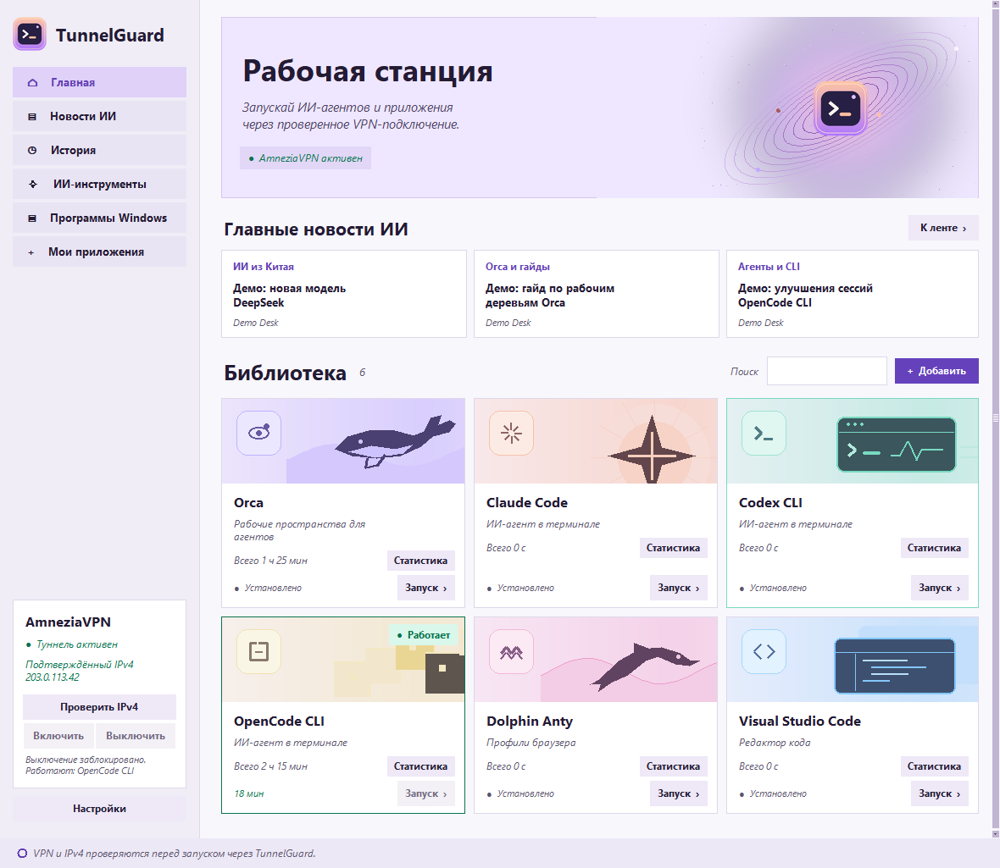
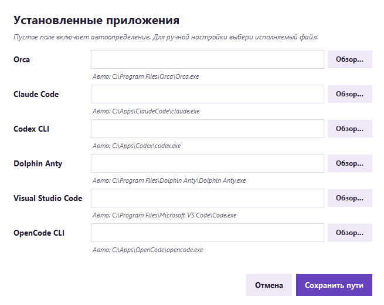
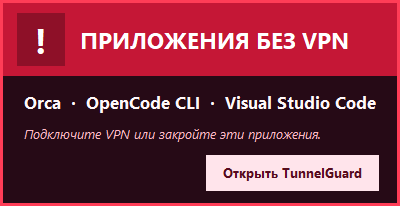
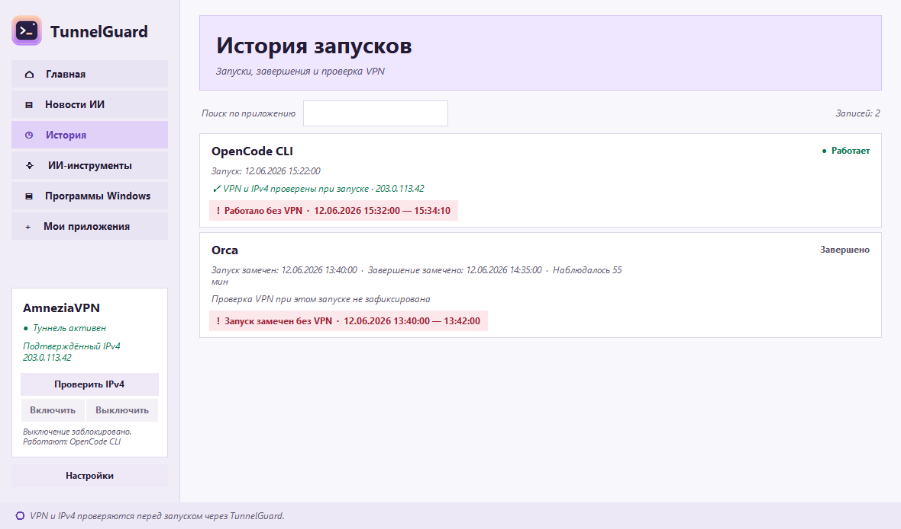
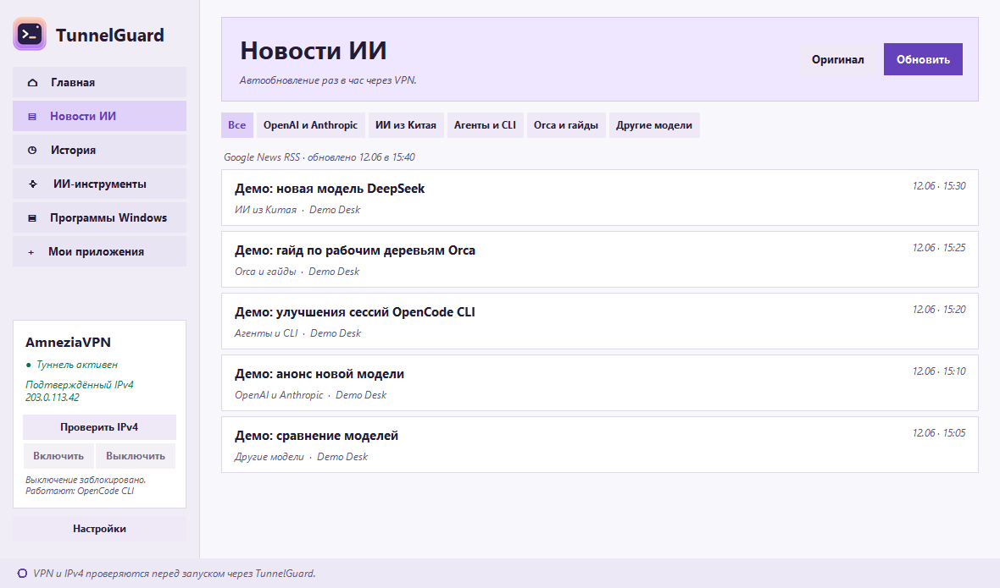

# TunnelGuard

TunnelGuard — лаунчер для Windows, который проверяет AmneziaVPN перед запуском ИИ-инструментов. В библиотеке уже есть **Orca, Claude Code, Codex CLI, OpenCode CLI, Dolphin Anty и Visual Studio Code**. Свои программы можно добавить через кнопку **«Добавить»**.

[**Скачать установщик для Windows x64**](https://github.com/Marks473/TunnelGuard/releases/latest)



*На скриншотах показаны демонстрационные данные.*

## Установка и первый запуск

1. На странице релиза в блоке **Assets** скачай файл `TunnelGuard-Setup-…-x64.exe`. Поддерживаются Windows 10 x64 (2004 и новее) и Windows 11 x64.
2. Запусти установщик. Он добавит TunnelGuard в меню «Пуск». Можно также выбрать ярлык на рабочем столе. Python, библиотеки и модель перевода входят в установщик. Для систем без Microsoft Visual C++ Redistributable x64 мастер предложит открыть официальную страницу Microsoft.
3. Установи и настрой AmneziaVPN и нужные приложения отдельно. Подключись через AmneziaVPN. Узнай внешний IPv4 у провайдера VPN или через сервис определения IP при активном VPN. В TunnelGuard введи его в поле **Настройки → Целевой внешний IPv4**. Для кнопки **«Включить»** в лаунчере укажи в тех же настройках **IPv4 сервера AmneziaWG** из карточки выбранного профиля. Если подключаешься в самом AmneziaVPN, адрес сервера можно оставить пустым. Эти два IPv4 могут различаться. Нажми **«Сохранить»**.
4. TunnelGuard ищет установленные приложения в стандартных локальных папках, `PATH` и поддерживаемых структурах установки CLI. Если карточка показывает «Не найдено», открой **Настройки → Пути приложений** и выбери нужный `.exe`. Чтобы снова включить автоопределение, очисти поле. Для npm-установки OpenCode выбирай нативный `opencode.exe` из `node_modules\opencode-ai\bin` рядом с npm-обёрткой, если автоопределение не нашло файл.
5. Подключи VPN и нажми **«Проверить IPv4»**. Перед запуском через лаунчер TunnelGuard повторит проверку. Для собственных консольных программ можно включить открытие отдельной консоли.

Внешний IPv4 и пути хранятся в профиле Windows. После первого запуска проверка IPv4, управляемый запуск и загрузка новостей доступны только после ввода целевого адреса.

**Обновление с 1.0.0.** Выбери **«Выйти»** в меню трея и запусти новый установщик в ту же папку. Настройки, список программ, история и кэш сохраняются в профиле Windows.

<details>
<summary>Скриншот настройки путей</summary>



</details>

## Что умеет TunnelGuard

| Раздел | Возможности |
| --- | --- |
| **Библиотека** | Карточки, поиск, отдельные категории и пользовательские приложения. У запущенных программ показывается время текущей наблюдаемой сессии. |
| **VPN** | Подключение выбранного профиля AmneziaWG и проверка внешнего IPv4 через два HTTPS-сервиса. Отключение через лаунчер блокируется, пока он видит работающие приложения из библиотеки. |
| **Новости ИИ** | Главные заголовки и отдельная лента с подборками по моделям, CLI, агентам и Orca. Заголовки переводятся локально. Кнопка «Оригинал» показывает исходный текст. |
| **История** | Время запуска и замеченного завершения, длительность, отметка о проверке VPN и интервалы работы без активного туннеля. В статистике видно время за сегодня, неделю и весь период. |
| **Трей** | Крестик скрывает окно, а мониторинг продолжается. Значок показывает состояние VPN. При работе приложения без туннеля рядом с панелью задач появляется красное предупреждение. Для полного завершения выбери «Выйти» в меню трея. |
| **Настройки** | Светлая и тёмная темы, настройка сворачивания в трей, пути приложений и автозапуск для текущего пользователя. |

## Предупреждения и история

Когда TunnelGuard видит работу программы из библиотеки без активного туннеля AmneziaVPN, рядом с панелью задач появляется красная плашка поверх окон, а в трее загорается **!**. Плашка перечисляет программы и исчезает, когда TunnelGuard видит, что VPN восстановился или все перечисленные программы закрыты. Завершённые интервалы остаются в истории. Правило наблюдения действует и для программ, запущенных из Orca, терминала или Проводника.



На вкладке **История** плашка в записи сеанса показывает, когда программа работала без активного туннеля. «Запуск замечен без VPN» означает, что приложение появилось в списке процессов при выключенном туннеле. «Работало без VPN» означает, что мониторинг обнаружил уже открытое приложение без туннеля. В завершённом интервале видны первая и последняя отметки наблюдения. Короткие события между проверками могут пройти незамеченными. Мониторинг работает, пока запущен TunnelGuard, в том числе в трее. Плашка показывает состояние VPN и процессов. Маршрут трафика конкретной программы по этой отметке определить нельзя.



<details>
<summary>Скриншот ленты новостей</summary>



</details>

## Как проходят сетевые проверки

- Перед управляемым запуском TunnelGuard проверяет маршрут через AmneziaVPN и сверяет заданный IPv4 с ответами двух сервисов. При расхождении, смене маршрута или ошибке проверок запуск отменяется.
- Для ленты используется Google News RSS. Приложение загружает заголовок, источник и дату через подтверждённый туннель и не запрашивает сайты издателей. DNS-запросы TunnelGuard отправляет через Cloudflare DoH по тому же адаптеру.
- Перевод заголовков выполняет локальная модель OPUS-MT. Сохранённую ленту можно читать и переводить офлайн. Автообновление ленты происходит примерно раз в час, пока открыто окно и доступен подтверждённый VPN.
- TunnelGuard применяет правила к запуску и отключению **из собственного интерфейса**. Прямой запуск приложений и отключение через Amnezia остаются доступны Windows. После обрыва VPN уже открытые программы остаются запущенными. Их сетевое поведение зависит от KillSwitch, раздельного туннелирования и маршрутизации в Amnezia. Плашка и история опираются на состояние локального туннеля. Целевой внешний IPv4 проверяется отдельно перед запуском через лаунчер и по кнопке «Проверить IPv4». [Как работает KillSwitch Amnezia](https://docs.amnezia.org/documentation/instructions/killswitch/)

Настройки, кэш новостей и история хранятся локально в `%LOCALAPPDATA%\TunnelGuard`. Установщик сохраняет этот профиль при обновлении.

## Сборка из исходников

Нужны Python 3.11 x64 с Tcl/Tk, Microsoft Visual C++ Redistributable x64 и Inno Setup 6.7 или новее. Запусти из корня репозитория в PowerShell.

```powershell
python -m venv .venv
$python = (Resolve-Path .\.venv\Scripts\python.exe).Path
& $python -m pip install -r requirements.txt "pyinstaller==5.8.0" "pyinstaller-hooks-contrib==2023.0"
& $python -B -m unittest -q
& $python scripts/prepare_translation_model.py
.\Build-Installer.ps1 -Python $python
```

Скрипт подготовки модели скачивает закреплённый архив OPUS-MT, проверяет SHA-256 и переводит веса в формат CTranslate2. Для сборки из уже скачанного архива используй `--archive путь-к-архиву`. Само приложение модель по сети не скачивает.

Результат сборки — `dist\TunnelGuard-Setup-1.1.0-x64.exe`. В той же папке лежит `SHA256SUMS.txt`. Установщик не подписан. Хеш скачанного установщика можно сверить с `SHA256SUMS.txt` из **Assets**. Команда ниже проверяет локально собранный файл.

```powershell
Get-FileHash .\dist\TunnelGuard-Setup-1.1.0-x64.exe -Algorithm SHA256
```

Чтобы запустить приложение из исходников после подготовки модели, выполни `& $python -B tunnelguard.py`. Демонстрационные скриншоты можно обновить командой `& $python -B scripts/generate_demo.py`.

## Лицензия

Код TunnelGuard распространяется по [MIT](LICENSE). У модели перевода и поставляемых зависимостей сохраняются [собственные лицензии](THIRD_PARTY_NOTICES.md).
